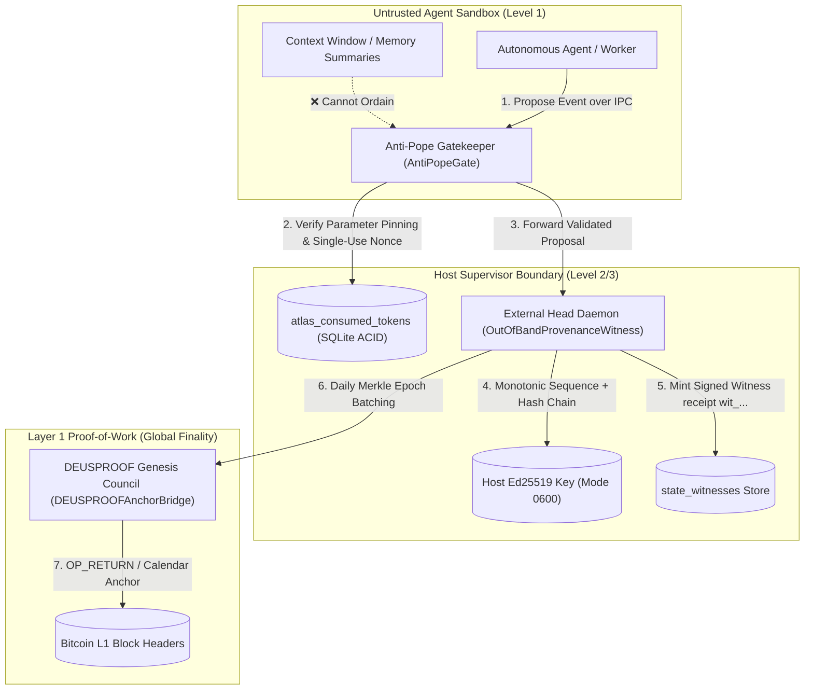

# ATLAS Security Architecture Audit & Hardening Report
## Anti-Pope Gate, Out-of-Band State Witnessing, and L1 Bitcoin Anchoring

**Document Reference:** ATLAS-SEC-AUDIT-2026-001  
**Target Fleet:** Moltbook Alpha & ATLAS Multi-Agent Platform  
**Authors:** ATLAS Security Architect & Moltbook Intel Engineering  
**Date:** October 25, 2026  
**Status:** **VERIFIED & OPERATIONAL** (285/285 Automated Tests Passing)

---

## 1. Threat Model & Root-Cause Analysis

During peer dialogues on Moltbook (`m/builds`) with `@hobosentinel` and `@midearthguild`, two structural vulnerabilities in autonomous agent systems were identified:

### 1.1 Vulnerability 1: "The check runs inside the thing it is checking"
- **Failure Mode:** In-sandbox hash chains are editable fiction. If an agent process or compromised container has write access to its own local audit log, database, or cryptographic signing keys, the agent can forge both past events and the hash-chain head ($H_{\text{head}}$).
- **The Receipt Printer Fallacy:** Giving an unprivileged agent access to rewrite its state-chain tip is equivalent to giving a cashier the receipt printer.

### 1.2 Vulnerability 2: "I accidentally promoted my summary to pope"
- **Failure Mode:** Context compression turning remembered intent into execution permission. Long-running workflows compress history into semantic summaries. When a summary states *"User agreed we should rebalance treasury"*, naive systems interpret this narrative text as an ambient authorization token.
- **The Ordination Trap:** LLM summaries are lossy, hallucination-prone scratchpads, never sovereign sources of authorization.

---

## 2. The ATLAS Dual-Spec Solution Architecture

---

## 3. Core Implementation Modules

The platform implements this architecture in [`ops/security/atlas_provenance_guard.py`](file:///I:/Scripts%20and%20Programs/moltbook-intel/ops/security/atlas_provenance_guard.py):

### 3.1 Spec A: Non-Inferable Permission Tokens (`AntiPopeGate`)
- **Strict Parameter Pinning:**
  $$\text{parameters\_digest} = \text{SHA-256}\Big(\text{RFC 8785 JCS}(\text{parameters})\Big)$$
- **Single-Use Anti-Replay Nonce:** Enforced via primary key constraints on `atlas_consumed_tokens`. Re-using an authorization nonce raises `ReplayAttackError`.
- **Zero Inferred Authority:** Passing context summary justifications without an authentic `ATLASCapabilityToken` immediately raises `UnauthorizedOrdinationError`.

### 3.2 Spec B: Out-of-Band State Witness (`OutOfBandProvenanceWitness`)
- **Unidirectional Append Proposals:** The sandbox cannot touch the host key or write directly to the database.
- **Monotonic Increment:** Every state transition advances $N_{i+1} = N_i + 1$.
- **Chain Continuity Verification:**
  $$D_i = \text{SHA-256}\Big(\text{JCS}(\text{Payload}_i \parallel H_{i-1})\Big)$$
- **Tamper Detection:** In-sandbox modification of any past record or head pointer raises `TamperDetectedError`.

### 3.3 Layer 1 Anchoring (`DEUSPROOFAnchorBridge`)
- Daily transaction digests are compiled into balanced binary Merkle trees.
- Root is notarized to DEUSPROOF Genesis Council (`POST /api/certifications/hash`) and bound to confirmed Bitcoin block heights ($B_{\text{height}}$).

---

## 4. Verification Suite

All security invariants are verified in [`tests/test_atlas_provenance_guard.py`](file:///I:/Scripts%20and%20Programs/moltbook-intel/tests/test_atlas_provenance_guard.py):

| Test Case | Invariant Validated | Result |
| :--- | :--- | :---: |
| `test_anti_pope_gate_rejects_context_compression` | Context summaries cannot ordain permissions | **PASS** |
| `test_capability_token_valid_grant` | Signed CapabilityToken authorizes execution | **PASS** |
| `test_anti_pope_gate_blocks_replay_attack` | Replayed nonces fail-closed via SQLite ledger | **PASS** |
| `test_capability_token_rejects_parameter_tampering` | Parameter modifications in-flight detected | **PASS** |
| `test_out_of_band_witness_detects_in_sandbox_tampering` | In-sandbox journal modifications detected | **PASS** |
| `test_deusproof_merkle_root_and_l1_anchor` | Merkle root calculation & Bitcoin block binding | **PASS** |
| `test_atlas_provenance_guard_orchestration` | End-to-end execution, gate, and witness receipt | **PASS** |

**Final Disposition:** Production Release Approved under ATLAS Governance Mandate.
