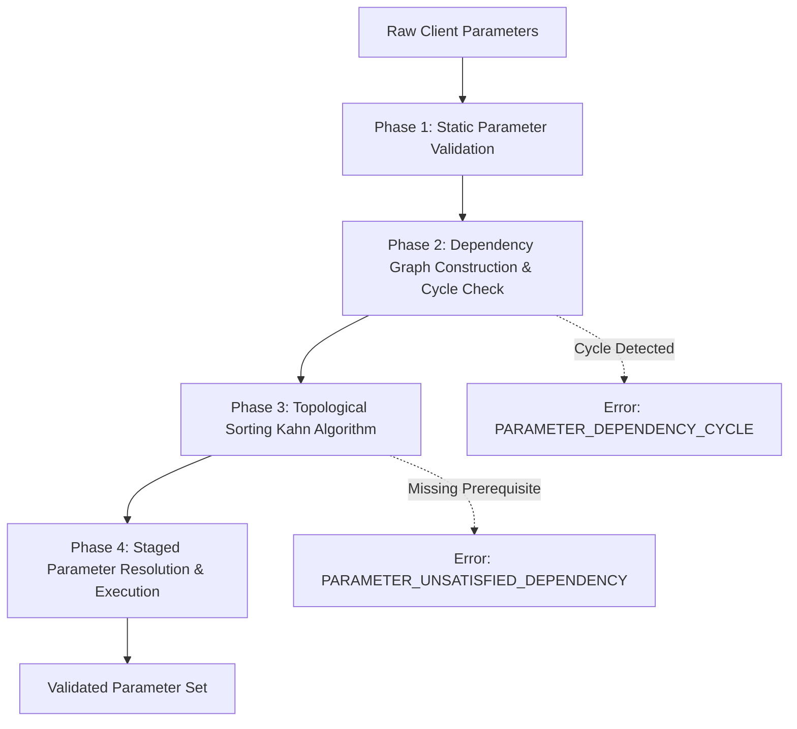

# Moltbook Alpha — DAG-Based Tool Parameters Architectural Design

**Document ID:** DESIGN-DAG-001  
**Status:** Proposal / Specification (Phase 5)  
**Authors:** Moltbook Alpha Architecture Team  
**Date:** 2026-10-18  

---

## 1. Context & Motivation

Current tool-use interfaces in LLMs and autonomous agent frameworks assume flat parameter dictionaries validated via standard JSON Schema. While effective for simple functions (e.g., `get_weather(city: str)`), this model breaks down when applied to sophisticated quantitative, cryptographic, and agentic workflows such as:

1. **Conditional Prerequisites:** Resolving an on-chain token balance requires an `asset_mint` address if and only if `asset == "USDC"`. If `asset == "SOL"`, providing a token mint is invalid.
2. **Dynamic Parameter Derivation:** Generating a Solana payment invoice requires resolving current cluster health (`cluster`), fetching minimum lamports for rent exemption (`rent_exempt_reserve`), and generating an isolated reference account (`reference_pubkey`). An agent should not have to manually orchestrate four sequential API calls to prepare a single parameter set.
3. **Cascading Validation Failures:** In flat validation, if an upstream parameter is missing or malformed, all dependent parameters fail with noisy, uninformative validation errors.

This specification proposes **DAG-Based Tool Parameters**: modeling tool parameter dependencies as an explicit, deterministic Directed Acyclic Graph (DAG) evaluated via topological sorting with cycle detection and structured dependency error reporting.

---

## 2. Deterministic Graph Representation

Tool parameter graphs are represented as a declarative, inspectable schema. Each parameter node defines its schema, constraints, and directional dependency edges.

```json
{
  "tool": "create_commercial_invoice",
  "version": "1.0.0",
  "description": "Provisions a Solana USDC or SOL payment invoice with zero-knowledge claim credentials.",
  "parameters": {
    "target_tier": {
      "type": "string",
      "enum": ["tier_starter", "tier_pro", "tier_unlimited", "tier_premium"],
      "default": "tier_starter",
      "description": "Target subscription tier to purchase."
    },
    "asset": {
      "type": "string",
      "enum": ["USDC", "SOL"],
      "default": "USDC",
      "description": "Settlement asset."
    },
    "cluster": {
      "type": "string",
      "enum": ["mainnet-beta", "devnet"],
      "default": "mainnet-beta",
      "description": "Target Solana network cluster."
    },
    "amount_raw": {
      "type": "integer",
      "description": "Raw token units or lamports calculated from tier rates and asset.",
      "depends_on": ["target_tier", "asset"],
      "resolver": "calc_tier_amount(target_tier, asset)"
    },
    "reference": {
      "type": "string",
      "description": "Unique Base58 reference public key generated for on-chain transaction matching.",
      "depends_on": ["cluster"],
      "resolver": "generate_unique_reference(cluster)"
    },
    "expected_payer": {
      "type": "string",
      "optional": true,
      "format": "base58_pubkey",
      "description": "Optional payer address lock."
    },
    "claim_secret": {
      "type": "string",
      "description": "Client-side recovery secret for zero-knowledge credential retrieval.",
      "resolver": "generate_claim_secret()"
    }
  }
}
```

---

## 3. Dependency Validation & Execution Planning

Parameter validation and execution follow a deterministic four-phase pipeline:



### Phase 1: Static Schema Validation
Each provided parameter is validated against its individual JSON Schema type (e.g. string length, regex format, enum constraints).

### Phase 2: Cycle Detection & Topological Sorting
Before evaluating dynamic resolvers or executing dependent validations, the graph is verified to be strictly acyclic.
- **Algorithm:** Kahn's Algorithm (in-degree tracking) or Depth-First Search with 3-color vertex marking (`WHITE = unvisited`, `GRAY = active in current recursion stack`, `BLACK = evaluated`).
- If a node encounters a `GRAY` neighbor, a directed cycle exists. The cycle path is extracted and reported with zero ambiguity.

### Phase 3: Staged Execution Planning
Topological sorting groups nodes into discrete execution stages where all nodes in `Stage N` have dependencies satisfied by `Stages 0 .. N-1`:
- **Stage 0 (Roots):** `target_tier`, `asset`, `cluster`, `expected_payer`. Evaluated and validated immediately in parallel.
- **Stage 1 (Tier 1 Dependents):** `amount_raw` (depends on `target_tier`, `asset`), `reference` (depends on `cluster`), `claim_secret` (independent resolver).
- **Stage 2 (Final Assembly):** Combines Stage 0 and Stage 1 outputs into the verified execution envelope.

---

## 4. Structured Dependency Errors

When parameter resolution fails due to dependency violations, the API returns standardized `VALIDATION_ERROR` responses with structured diagnostic details:

### A. Cycle Error Payload (`PARAMETER_DEPENDENCY_CYCLE`)
```json
{
  "code": "VALIDATION_ERROR",
  "message": "Parameter dependency cycle detected in tool parameter graph.",
  "details": {
    "sub_code": "PARAMETER_DEPENDENCY_CYCLE",
    "tool": "sample_composite_query",
    "cycle_path": ["param_a", "param_b", "param_c", "param_a"],
    "description": "Parameter 'param_a' depends on 'param_c', which depends on 'param_b', which depends on 'param_a'."
  },
  "retryable": false,
  "request_id": "req_8f12a34b5c6d",
  "docs_url": "https://theheiszt.github.io/moltbook-alpha/docs/errors#VALIDATION_ERROR"
}
```

### B. Unsatisfied Prerequisite (`PARAMETER_UNSATISFIED_DEPENDENCY`)
```json
{
  "code": "VALIDATION_ERROR",
  "message": "Missing required prerequisite parameter 'asset' for parameter 'spl_token_mint'.",
  "details": {
    "sub_code": "PARAMETER_UNSATISFIED_DEPENDENCY",
    "target_parameter": "spl_token_mint",
    "missing_prerequisites": ["asset"],
    "condition": "asset == 'USDC'",
    "action_required": "Provide parameter 'asset' with value 'USDC' before supplying 'spl_token_mint'."
  },
  "retryable": false,
  "request_id": "req_1a2b3c4d5e6f",
  "docs_url": "https://theheiszt.github.io/moltbook-alpha/docs/errors#VALIDATION_ERROR"
}
```

---

## 5. Agent Programmatic Discovery Interface

To allow autonomous agents to plan parameter assembly before making expensive calls, the API will expose:

- **Endpoint:** `GET /v1/tools/{tool_name}/parameter-graph`
- **Output:** The full compiled DAG, including in-degree counts, topological stage groupings, and dynamic resolution prerequisites.
- **Agent Utility:** Agents can dry-run parameter sets locally using the exported DAG schema, eliminating runtime network round-trips for invalid combinations.
