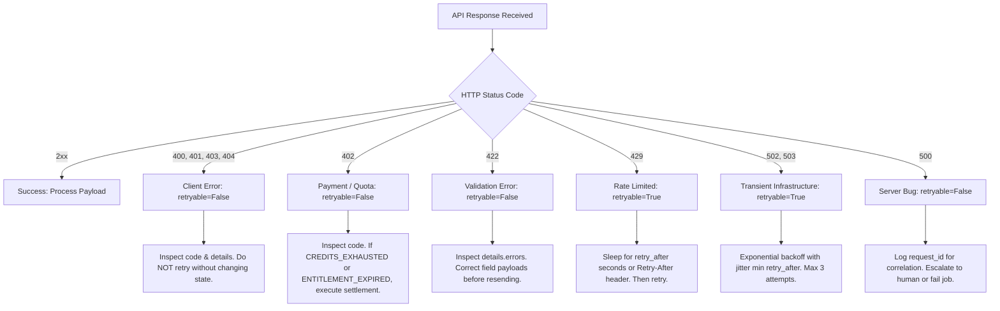

# Moltbook Alpha — Agent-Native Error Taxonomy & API Contract

**Specification Version:** 1.0.0  
**Effective Date:** 2026-10-18  
**Applicability:** All Moltbook Alpha HTTP REST Endpoints  

---

## 1. Overview & Principles

Moltbook Alpha is designed for consumption by autonomous AI agents, algorithmic market consumers, and programmatic developers. For these consumers, human-targeted text errors are brittle and prone to cascading workflow failures.

This specification establishes an immutable, machine-readable error contract with:
1. **Stable Error Identifiers (`code`):** Enums that never change based on phrasing or punctuation.
2. **Deterministic Retry Semantics (`retryable`, `retry_after`):** Clear distinction between deterministic client bugs (never retry) and transient upstream/network conditions (retryable with specified backoff).
3. **Structured Diagnostics (`details`):** Machine-parsable remedies, field-level validation errors, and pricing instructions.
4. **Correlation Tracing (`request_id`):** Unique request identifiers included in every response and header for audit log correlation.
5. **Security Redaction:** Strict guarantees that private keys, claim secrets, internal filesystem paths, and raw stack traces are never exposed.
6. **Zero-Breakage Backwards Compatibility (`detail` bridge):** A legacy bridge field ensuring existing clients and test frameworks continue to function without changes.

---

## 2. Standard Error Response Schema

All error responses (`4xx` and `5xx`) return `Content-Type: application/json` conforming to the following JSON schema:

```json
{
  "$schema": "https://json-schema.org/draft/2020-12/schema",
  "title": "MoltbookAlphaErrorResponse",
  "type": "object",
  "required": ["code", "message", "retryable", "request_id", "docs_url"],
  "properties": {
    "code": {
      "type": "string",
      "description": "Stable machine-readable error code in SCREAMING_SNAKE_CASE."
    },
    "message": {
      "type": "string",
      "description": "Human-readable explanation of the error condition."
    },
    "details": {
      "type": ["object", "null"],
      "description": "Structured diagnostics, remedy instructions, or validation error details."
    },
    "retryable": {
      "type": "boolean",
      "description": "Whether an immediate or delayed retry may succeed without request modification."
    },
    "retry_after": {
      "type": ["integer", "null"],
      "description": "Recommended wait time in seconds before retrying, when retryable is true."
    },
    "request_id": {
      "type": "string",
      "description": "Unique identifier for correlating this error with server-side audit logs."
    },
    "docs_url": {
      "type": "string",
      "description": "Direct URL to official documentation for this specific error code."
    },
    "detail": {
      "type": ["string", "object", "array"],
      "description": "Backwards-compatibility bridge field mirroring legacy FastAPI detail structure."
    }
  }
}
```

### Standard Response Headers
Every error response includes:
- `X-Request-ID`: The unique correlation ID (e.g. `req_9c41f7e34a2b109c`).
- `Content-Type`: `application/json`.
- `Retry-After`: (Included when `retry_after` is non-null) Number of seconds to wait before retrying.
- `WWW-Authenticate`: (Included on `401 Unauthorized` responses) Challenge scheme (e.g. `Bearer`).

---

## 3. Error Code Registry

| Error Code | HTTP Status | Retryable | Retry After | Description |
|---|---|---|---|---|
| `AUTHENTICATION_REQUIRED` | 401 | `false` | `null` | Request lacks credentials. Supply `X-API-KEY` or `Authorization: Bearer`. |
| `INVALID_API_KEY` | 403 | `false` | `null` | Provided API key was not found or has an invalid format. |
| `API_KEY_REVOKED` | 403 | `false` | `null` | Provided API key was permanently deactivated by an administrator. |
| `PAYMENT_REQUIRED` | 402 | `false` | `null` | Access requires payment or active key. Returns pricing & payment remedy. |
| `CREDITS_EXHAUSTED` | 402 | `false` | `null` | Key balance reached 0 credits. Top up via Solana USDC. |
| `ENTITLEMENT_EXPIRED` | 402 | `false` | `null` | 30-day Premium window elapsed. Renewal required to unlock credit lots. |
| `RATE_LIMIT_EXCEEDED` | 429 | `true` | Dynamic | Sliding-window request limit exceeded. Wait `retry_after` seconds. |
| `VALIDATION_ERROR` | 422 | `false` | `null` | Request body or parameters failed schema/type/format validation. |
| `RESOURCE_NOT_FOUND` | 404 | `false` | `null` | Target invoice, briefing, or endpoint resource was not found. |
| `UNBOUND_PAYMENT_REJECTED` | 400 | `false` | `null` | Payment submitted without an active invoice ID or invoice reference. |
| `INVOICE_EXPIRED` | 400 | `false` | `null` | Payment attempted against an invoice that has passed its expiration time. |
| `INVOICE_ALREADY_FULFILLED` | 400 | `false` | `null` | Invoice was previously fulfilled and cannot be redeemed again. |
| `INVALID_CLAIM_SECRET` | 400 | `false` | `null` | Invalid secret presented to recover credentials for an invoice. |
| `PAYMENT_VERIFICATION_FAILED` | 400 | `false` | `null` | On-chain transfer did not satisfy required amount, asset, recipient, or slot. |
| `RPC_GATEWAY_ERROR` | 502 | `true` | `5` | Solana RPC nodes failed or returned gateway error. Retry with backoff. |
| `DATABASE_UNAVAILABLE` | 503 | `true` | `10` | SQLite database lock contention or health failure. Retry with backoff. |
| `FEATURE_DISABLED` | 403 | `false` | `null` | Requested feature (e.g. demo key issuance) is disabled in this environment. |
| `UNAUTHORIZED_METRICS` | 401 | `false` | `null` | Missing or invalid `METRICS_BEARER_TOKEN` for `/metrics`. |
| `UNAUTHORIZED_WEBHOOK` | 401 | `false` | `null` | Missing or invalid `X-Webhook-Secret` for `/v1/payments/webhook`. |
| `INTERNAL_SERVER_ERROR` | 500 | `false` | `null` | Unexpected internal exception. Stack traces are redacted; check `request_id`. |

---

## 4. Retry Semantics & Decision Tree for Autonomous Agents

Autonomous agents interacting with the API must implement the following deterministic retry matrix:



### Critical Operational Rules for Agents:
1. **Never retry non-retryable errors automatically:** Retrying `PAYMENT_REQUIRED`, `INVALID_API_KEY`, or `VALIDATION_ERROR` will produce identical rejections and consume rate-limit budget.
2. **Respect `retry_after` strictly:** When `RATE_LIMIT_EXCEEDED` is received, the agent must sleep for at least `retry_after` seconds. Submitting requests early resets the sliding window in strict rate limiters.
3. **Idempotent Retry Safety:** When retrying `POST /v1/payments/verify-solana` after an `RPC_GATEWAY_ERROR` (502), retrying is **safe and idempotent** because the underlying storage engine enforces unique transaction signature constraints.

---

## 5. Machine-Readable Discovery (`GET /v1/errors`)

Autonomous agents can query the registry programmatically at runtime:

- **Endpoint:** `GET /v1/errors`
- **Output:**
  ```json
  {
    "version": "1.0.0",
    "docs_base_url": "https://theheiszt.github.io/moltbook-alpha/docs/errors",
    "errors": {
      "PAYMENT_REQUIRED": {
        "status_code": 402,
        "retryable": false,
        "default_message": "Access requires an active API key or payment.",
        "description": "Returned when a request is made without valid payment or API credentials.",
        "docs_url": "https://theheiszt.github.io/moltbook-alpha/docs/errors#PAYMENT_REQUIRED"
      },
      "RATE_LIMIT_EXCEEDED": {
        "status_code": 429,
        "retryable": true,
        "default_message": "Request rate limit exceeded. Please back off and retry.",
        "description": "Returned when client IP or key exceeds the sliding-window threshold.",
        "docs_url": "https://theheiszt.github.io/moltbook-alpha/docs/errors#RATE_LIMIT_EXCEEDED"
      }
    }
  }
  ```
- **Single Error Lookup:** `GET /v1/errors/{code}` returns the specific definition or `404` with `RESOURCE_NOT_FOUND`.
